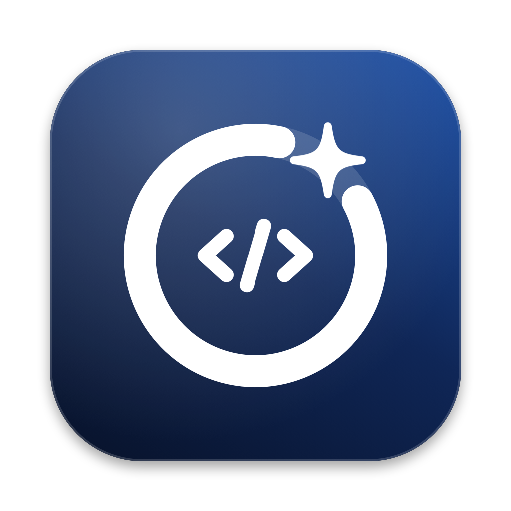

<p align="center"></p>

# DevSweep

A native macOS (SwiftUI, macOS 14+, Apple Silicon & Intel) cleaner and system monitor for developers.
Includes logic adapted from [Mac Sai](https://github.com/iliyami/MacSai) (BSD 3-Clause); see [THIRD_PARTY_NOTICES.md](THIRD_PARTY_NOTICES.md).

## Install

```bash
brew trust --cask moovendhan-v/tap/devsweep   # Homebrew 7+: trust this one cask from the tap
brew install --cask moovendhan-v/tap/devsweep
```

Update with `brew upgrade --cask devsweep`; remove with `brew uninstall --cask devsweep` (add `--zap` to also delete its settings).

| Section | Modules |
| --- | --- |
| **Smart Care** | One-click checkup (junk, dev caches, projects, large files, malware, memory, apps) → checklist → **Run**. |
| **Cleanup** | System Junk (app/browser/Electron caches, logs, mail attachments, iOS backups, old updates, temp files, broken prefs & login items, leftovers of deleted apps, deleted users, unused languages, universal-binary thinning, Trash), Developer Caches (found dynamically), Project Folders, **Clean History** with one-click Restore. |
| **Protection** | Malware scan (Quick/Balanced/Deep, signatures + unsigned/suspicious launch items, real-time watcher), Privacy (browser history, caches, cookies, form data, recent items), Browser Extensions, Saved Wi-Fi, App Permissions overview. |
| **Speed** | Memory & Swap (live breakdown, pressure, swap files, history, Speed Up), Optimization (login items & launch agents on/off, CPU hogs), Maintenance (flush DNS, purgeable space, verify disk, Launch Services, Spotlight, Time Machine snapshots, fonts, Mail; "Run All Safe Tasks" with one password), **Network** (live speed, today by hour, 7/30/90-day history, per-app traffic). |
| **Applications** | Uninstaller (+ Reset to Defaults, unused 3/6/12 months, leftovers of deleted apps), Updater (Homebrew casks + Sparkle feeds), Extensions (pref panes, plug-ins, Quick Look, Spotlight, app extensions), Default Apps. |
| **Files** | Space Lens treemap, Large & Old Files, Duplicates (+ APFS-clone consolidation), Shredder. |
| **Automation** | Scheduled tasks (dev caches, junk, DerivedData, brew cleanup, Docker prune, stale node_modules, empty Trash, network/disk reports, custom commands) via a background agent; optional daily wake; Keep Mac Awake. |
| **Menu bar** | CPU / memory / disk / battery rings, ↓↑ network speed, data used today, tips, external drives, Keep Awake, Free RAM. Label can show RAM, CPU, network speed, data today or free disk. |
| **Onboarding** | First-launch guide for Full Disk Access, background activity, open at login and notifications. |

### Running in the background

While a Mac sleeps no app can run. DevSweep: (1) keeps the Mac awake while a task runs, (2) registers a background
agent with `SMAppService` (macOS shows "App Background Activity" and lists it in Login Items & Extensions) that checks
every 15 minutes and immediately after wake, and (3) can schedule a daily `pmset` wake so tasks run at their time.

### About swap

macOS manages swap itself: the kernel creates and deletes `/System/Volumes/VM/swapfile*` as needed, on a volume
protected by System Integrity Protection. No app can safely create, resize or delete swap files. DevSweep shows exactly
how much swap is used and how fast it's being read and written, and shrinks it the safe ways: freeing RAM, quitting
heavy apps, or restarting (which clears all swap).

## Dynamic cache discovery

Cache locations aren't only hard-coded ([Discovery.swift](Sources/DevSweep/Discovery.swift)):

1. **Ask the tools.** `npm config get cache`, `yarn cache dir`, `pnpm store path`, `deno info --json`, `pip3 cache dir`,
   `uv cache dir`, `brew --cache`, `composer config --global cache-dir`, `conda info --base`, `go env GOCACHE/GOMODCACHE`,
   `$CARGO_HOME`, `$GRADLE_USER_HOME`. Probes run from `$HOME` with a 12 s timeout and corepack downloads disabled.
2. **Ask Docker** how much it can reclaim (`docker system df`) and clean it with `docker … prune`.
3. **Scan the disk.** Every folder in `~/Library/Caches` (named after its app, with its icon), Chromium/Electron cache
   folders inside `~/Library/Application Support/*`, `~/.cache/*`, and `cache`/`logs`/`tmp` folders inside `~/.<tool>`.
4. **Classify** each one into a developer or junk group by name. Big downloads (Playwright browsers, ML models) are
   marked "Review first" and aren't pre-selected.

Anything already covered by another entry is skipped, so nothing is counted twice. Expand any row to clean individual
sub-folders (e.g. one DerivedData project).

## Safety

- Cleaning moves items to the Trash by default. Turn off "Move to Trash" to delete permanently.
- Only items marked safe are pre-selected. "Review first" items need an explicit tick.
- Give DevSweep **Full Disk Access** (System Settings › Privacy & Security) for a complete scan, including the Trash.

## Build

    ./build_app.sh                 # universal build/DevSweep.app
    ARCHS=arm64 ./build_app.sh     # faster, Apple Silicon only
    open build/DevSweep.app

The script calls `swiftc` directly (no Xcode needed), uses the newest SDK that matches the installed compiler, and
regenerates the icon from `scripts/make_icon.swift` if `Resources/AppIcon.icns` is missing.

## Release to Homebrew

One-time setup: a public repo `moovendhan-v/devsweep` (this code) and a public repo `moovendhan-v/homebrew-tap` (the cask).

    echo 1.0.1 > VERSION
    GITHUB_OWNER=moovendhan-v scripts/release.sh            # build, zip, write homebrew-tap/Casks/devsweep.rb
    GITHUB_OWNER=moovendhan-v scripts/release.sh --publish  # + GitHub release upload + push the tap

The cask template lives in `packaging/devsweep.rb.template`. Releases are ad-hoc signed, so the cask clears the
quarantine flag after install. For a smoother first launch (and to qualify for the official homebrew-cask repo),
sign with a Developer ID: `SIGN_IDENTITY="Developer ID Application: …" ./build_app.sh`, then notarize the zip with
`xcrun notarytool submit … --wait` and drop the `postflight_steps` block.
